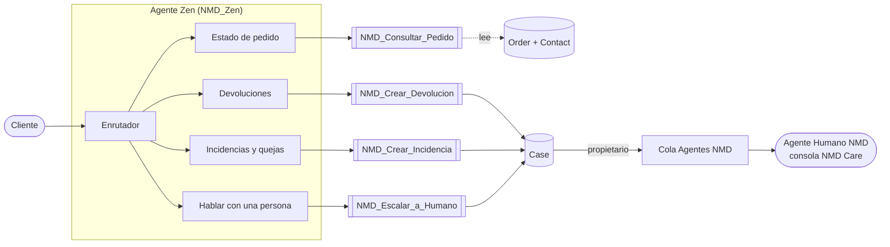

# Demo 1 — NMD Care: atención al cliente con Agentforce

**No More Drama (NMD)** es una marca ficticia creada para este portfolio. Tiene dos líneas de negocio:

- **NMD Beverage**: cervezas (Lager Zen, IPA Sin Drama, Stout Plan B y Radler Todo Bien).
- **NMD Clinic**: kits de detox digital de 7 y 30 días.

Esta demo construye en Salesforce un servicio de atención al cliente con un agente de IA, **Zen**, y una consola para el equipo humano, **NMD Care**.

---

## 1. Problema de negocio

NMD vende a bares, restaurantes, festivales, un distribuidor y clientes particulares. El equipo de soporte recibe sobre todo cuatro tipos de consulta:

1. **"¿Dónde está mi pedido?"**: consultas de estado y retrasos, muy repetitivas.
2. **Devoluciones** de pedidos ya entregados.
3. **Incidencias y quejas**: producto defectuoso o un retraso que deja a un festival sin cerveza.
4. Clientes que **quieren hablar con una persona**, a menudo enfadados.

Las consultas repetitivas ocupan al equipo y las urgentes se mezclan con ellas. Además, no se puede dar información de un pedido a quien no es su cliente.

## 2. Solución

| Pieza | Qué hace |
|---|---|
| **Zen** (Agentforce Service Agent) | Atiende en español, tuteando y con tono "cero drama". Consulta pedidos, registra devoluciones e incidencias, y pasa a una persona con un resumen de la conversación. |
| **4 Flows invocables** | Son las acciones de Zen. Verifican la identidad del cliente y aplican las reglas de negocio de forma determinista. |
| **Consola NMD Care** | App de consola Lightning donde el equipo humano trabaja los casos que llegan a la cola **Agentes NMD**. |
| **Modelo de datos** | Pedidos con estado de envío y fecha prevista; casos vinculados al pedido y con origen "Agente Zen". |

**Reparto de responsabilidades:**
- **El agente** conversa, entiende la intención, pide los datos que faltan, ajusta el tono y resume la conversación.
- **Los Flows** deciden: si el cliente está verificado, si un pedido se puede devolver y qué prioridad tiene un caso.

La IA no toma ninguna decisión de negocio que pueda variar entre conversaciones.

---

## 3. Arquitectura



### 3.1 Modelo de datos

| Elemento | Tipo | Detalle |
|---|---|---|
| `Product2.Linea_de_negocio__c` | Picklist restringida | Beverage o Clinic |
| `Order.Estado_envio__c` | Picklist restringida | Pendiente, Enviado, Entregado o Retrasado |
| `Order.Fecha_prevista_entrega__c` | Fecha | Fecha comprometida con el cliente |
| `Case.Pedido__c` | Búsqueda a Order | En el pedido aparece la lista relacionada "Casos NMD" |
| `Case.Type` (CaseType) | Valores añadidos | Consulta de pedido, Devolución, Producto defectuoso y Queja |
| `Case.Origin` (CaseOrigin) | Valor añadido | Agente Zen |

**Datos de demo** (`data/nmd-demo-data.apex`), 130 registros en total:
- 6 productos con sus precios en el Standard Price Book.
- 8 cuentas y 20 contactos.
- 25 pedidos con 50 líneas.
- 15 casos.

Las fechas de los pedidos se calculan a partir del día de carga, para que el estado de envío siempre encaje con ellas.

### 3.2 App, cola y usuarios

| Elemento | Detalle |
|---|---|
| App **NMD Care** (`NMD_Care`) | Consola Lightning con pestañas Casos, Pedidos, Cuentas y Contactos, y cabecera #1B1B1B |
| Cola **Agentes NMD** | Recibe todos los casos que crean los Flows de Zen |
| Permission set **NMD Base** | Acceso a la app y a los campos NMD |
| Usuario **Agente Humano NMD** | Licencia Salesforce y Service Cloud User; miembro de la cola y con NMD Base |
| Usuario **Zen Agente NMD** | Einstein Agent User con `AgentforceServiceAgentUser` y **NMD Zen Agent** (solo acceso a los 4 Flows) |

### 3.3 Flows (acciones del agente)

Los 4 son autolanzados, se pueden invocar como acción, se ejecutan en modo sistema sin sharing y están en Auto-Layout.

| Flow | Entradas | Salidas | Reglas |
|---|---|---|---|
| `NMD_Consultar_Pedido` | numeroPedido, email | verificado, estadoEnvio, fechaPrevista, mensaje | Solo devuelve datos si el email coincide con el contacto de facturación del pedido. Si no, responde "no verificado" sin dar ningún dato. |
| `NMD_Crear_Devolucion` | numeroPedido, email, motivo | verificado, numeroCaso, mensaje | Misma verificación. Solo crea el caso si el pedido está **Entregado**: tipo Devolución, vinculado a pedido, contacto y cuenta, y asignado a la cola. |
| `NMD_Crear_Incidencia` | email, numeroPedido (opcional), tipo, descripcion, gravedad | verificado, numeroCaso, mensaje | El email tiene que ser de un contacto, y el pedido, si se indica, tiene que ser suyo. **Queja + gravedad Alta = prioridad High**; el resto, Medium. Asignado a la cola. |
| `NMD_Escalar_a_Humano` | email, numeroPedido (opcional), resumen | numeroCaso, mensaje | Siempre crea un caso High en la cola. Si el email es de un contacto, lo vincula; si no, guarda el email en Web Email. Si el cliente da un número de pedido que es suyo (BillToContact = ese contacto), vincula el caso al pedido; si no, lo crea sin pedido. Zen pasa el número cuando el cliente lo ha mencionado. |

Todos los casos creados tienen **Origin = Agente Zen**.

### 3.4 Agente Zen

Está escrito en **Agent Script** (`aiAuthoringBundles/NMD_Zen/NMD_Zen.agent`) y publicado como **NMD_Zen v1**.

- **Enrutador:** elige el topic. Si el mensaje es un saludo, saluda. Si es un tema que no le corresponde, lo dice con amabilidad y reconduce. Si el cliente pide expresamente devolver un pedido, va a Devoluciones aunque mencione un defecto.
- **Topics:** Estado de pedido, Devoluciones, Incidencias y quejas, Hablar con una persona. Cada uno tiene una sola acción, que llama a su Flow.
- **Reglas en todos los topics:**
  - Pide número de pedido y email antes de consultar o devolver.
  - Nunca inventa datos.
  - Tras 2 verificaciones fallidas, ofrece pasar con una persona.
  - Si el cliente está muy enfadado o pide una persona, escala.
  - Siempre da el número de caso.
  - No promete acciones que no puede hacer.

---

## 4. Decisiones y adaptaciones por la Developer Edition

| Límite o hallazgo | Decisión |
|---|---|
| **5 MB** de almacenamiento de datos | Los datos de demo se limitan a 130 registros, unos 260 KB. Los casos de prueba se borran siempre después de las pruebas. |
| `Order.Status` solo admite Draft y Activated | Se mantiene el estado estándar y se añaden `Estado_envio__c` y `Fecha_prevista_entrega__c` para la logística. |
| `Case.Type` y `Case.Reason` traen los valores de ejemplo de Salesforce | Se añaden los 4 tipos de NMD al conjunto estándar CaseType, conservando los valores existentes. |
| La org usa picklists de país y provincia, y España no tiene provincias | Se usa el código de país `ES`, y la provincia va en la descripción de la cuenta. |
| Standard Price Book inactivo | El script de datos lo activa, porque sin él no se pueden crear líneas de pedido. |
| Solo **4 licencias Salesforce** | 3 en uso: admin, integración y Agente Humano NMD. |
| `sf org create user` solo funciona en scratch orgs | Los usuarios se crean con scripts de Apex anónimo que se pueden ejecutar varias veces sin duplicar nada (`data/`). |
| **Solo 10 conversaciones de Messaging** en total | Zen se prueba en la **vista previa** de Agentforce Builder, que no gasta ese cupo. Todavía no tiene canal publicado. |
| Messaging for Web suele requerir Digital Experiences | Se deja para una fase posterior. No se han activado Quotes, Knowledge ni Digital Experiences. |
| El servidor MCP del plugin para generar Flows no conectaba | El XML de los Flows se escribió a mano, se validó con un despliegue de prueba (dry-run) y se probó con la API REST de acciones invocables. |
| Auto-Layout no puede dibujar ramas que saltan a un paso compartido | Cada rama "no verificado" acaba en su propio paso final. |
| Plantilla del CLI con `@utils.escalate` | Sin canal de Messaging no hay a dónde transferir la conversación. El escalado crea un caso en la cola mediante un Flow. |
| Modelos de IA de Prompt Builder | No se pudieron verificar por API. Hay que comprobarlos en Einstein Studio. |

---

## 5. Seguridad e IA responsable

**Protección de datos**
- **Verificación antes de dar datos.** Para ver o devolver un pedido hacen falta su número y el email de su contacto de facturación.
- **Sin pistas para adivinar datos.** "Pedido inexistente" y "email incorrecto" dan exactamente la misma respuesta, así que no se puede averiguar qué números de pedido existen.
- **Sin casos sobre pedidos ajenos.** Una incidencia sobre un pedido de otro cliente se rechaza.
- **Permisos mínimos para el agente.** Su usuario solo puede ejecutar los 4 Flows. Los Flows se ejecutan en modo sistema, pero la verificación está dentro de ellos y la IA no puede saltársela.
- **Datos ficticios.** Todos los emails son `@example.com` y no hay ningún dato personal real.

**Comportamiento de la IA**
- **No inventa datos.** Las instrucciones obligan a usar solo lo que devuelven las acciones, y en las pruebas se corrigió una promesa que el agente no podía cumplir.
- **Dice que es una IA.** Zen se presenta como asistente virtual si se le pregunta.
- **Bienestar** (NMD Clinic). No da consejos médicos ni psicológicos. Ante angustia seria, recomienda el 112 o un profesional y ofrece pasar con una persona.
- **Resistencia a manipulación.** Ignora los intentos de cambiar sus reglas y no revela sus instrucciones.
- **Siempre hay una persona disponible.** Se ofrece tras 2 verificaciones fallidas y se activa con enfado o petición expresa, con un resumen para que el cliente no tenga que repetirse.
- **Tono adecuado.** No hace bromas con clientes enfadados ni con quejas graves.

**Limitación conocida:** número de pedido + email es una verificación suficiente para una demo, pero débil en producción. Con un canal autenticado, la identidad debería venir de la sesión de Messaging (`ContactId`) o de un código de un solo uso.

---

## 6. Cómo desplegarla en otra org

**Requisitos:**
- Una org con Agentforce, por ejemplo una Developer Edition de Agentforce.
- Licencias Einstein Agent y Service Cloud User.
- Omni-Channel no es obligatorio.
- Salesforce CLI con el plugin `agent`.

```bash
# 0. Conectar la org
sf org login web --alias mi-org
sf config set target-org mi-org
```

**1. Revisar los conjuntos de valores estándar.**

Un despliegue de `StandardValueSet` **reemplaza el conjunto entero**. Si la otra org tiene valores propios en `CaseType` o `CaseOrigin`, descárgalos primero y combínalos con los de NMD; si no, los valores que falten se desactivarán.

```bash
sf project retrieve start --metadata StandardValueSet:CaseType StandardValueSet:CaseOrigin --output-dir tmp-svs
```

**2. Desplegar la metadata.**

Despliega solo estos tipos. No despliegues `aiAgents/` ni `aiAgentDefinitionVersions/`: son la copia de la versión publicada en nmd-dev.

```bash
sf project deploy start --dry-run \
  --metadata StandardValueSet:CaseType StandardValueSet:CaseOrigin \
  --metadata CustomField:Product2.Linea_de_negocio__c CustomField:Order.Estado_envio__c \
  --metadata CustomField:Order.Fecha_prevista_entrega__c CustomField:Case.Pedido__c \
  --metadata Queue:Agentes_NMD CustomApplication:NMD_Care \
  --metadata PermissionSet:NMD_Base Flow:NMD_Consultar_Pedido Flow:NMD_Crear_Devolucion \
  --metadata Flow:NMD_Crear_Incidencia Flow:NMD_Escalar_a_Humano PermissionSet:NMD_Zen_Agent
# Si la validación pasa, repite el comando sin --dry-run.
sf org assign permset --name NMD_Base
```

**3. Cargar los datos de demo.**

El script usa `BillingCountryCode`, que necesita los picklists de país y provincia activados. Si la org no los tiene, cambia los campos `*CountryCode` por `*Country`.

```bash
sf apex run --file data/nmd-demo-data.apex
```

**4. Crear los usuarios.**

Antes, cambia `USERNAME` en ambos scripts, porque tiene que ser único en todo Salesforce:

```bash
sf apex run --file data/nmd-agente-humano.apex
sf apex run --file data/nmd-zen-agent-user.apex
```

**5. Publicar el agente.**

Primero pon en `access.default_agent_user` de `NMD_Zen.agent` el username del paso anterior:

```bash
sf agent validate authoring-bundle --api-name NMD_Zen --json
sf project deploy start --metadata AiAuthoringBundle:NMD_Zen --json
sf agent publish authoring-bundle --api-name NMD_Zen --json
sf agent activate --api-name NMD_Zen --json
```

**Limpieza:** `sf apex run --file data/nmd-cleanup.apex` borra los datos de demo y todos los casos "Agente Zen". No toca la metadata ni los usuarios.

---

## 7. Guion de pruebas

Los números de pedido de los ejemplos son los de nmd-dev. En otra org, el número automático puede empezar en otro valor: consulta los tuyos con

```bash
sf data query -q "SELECT OrderNumber, Estado_envio__c, BillToContact.Email FROM Order ORDER BY OrderNumber"
```

### 7.1 Flows (API REST de acciones invocables)

```bash
sf api request rest "/services/data/v68.0/actions/custom/flow/NMD_Consultar_Pedido" --method POST \
  --body '{"inputs":[{"numeroPedido":"00000110","email":"carmen.soler@example.com"}]}'
```

En Git Bash de Windows, exporta antes `MSYS_NO_PATHCONV=1`. Si no, Git Bash convierte la ruta `/services/...` en una ruta de disco y la API responde `NOT_FOUND`.

| # | Flow | Entrada | Resultado esperado |
|---|---|---|---|
| 1 | Consultar | 00000110 + `Carmen.Soler@example.com` | verificado; Retrasado; "…la fecha prevista era el 01/11/2026…" (no distingue mayúsculas) |
| 2 | Consultar | 00000110 + `lucia.martin@example.com` | no verificado; sin estado ni fecha |
| 3 | Devolución | 00000107 + `marta.lopez@example.com` | caso tipo Devolución, Medium, en la cola, vinculado al pedido |
| 4 | Devolución | 00000107 + `andres.prieto@example.com` (misma cuenta, otro contacto) | no verificado; sin caso |
| 5 | Devolución | 00000112 + `marta.lopez@example.com` (Retrasado) | verificado; sin caso; "Solo se pueden devolver pedidos entregados" |
| 6 | Incidencia | Queja, Alta, 00000111, `sergio.blasco@example.com` | caso **High** en la cola |
| 7 | Incidencia | Producto defectuoso, Media, sin pedido, `carmen.soler@example.com` | caso Medium en la cola, sin pedido |
| 8 | Incidencia | 00000111 + `lucia.martin@example.com` (pedido ajeno) | no verificado; sin caso |
| 9 | Escalar | `marc.vidal@example.com` + resumen | caso High en la cola, vinculado a contacto y cuenta |
| 10 | Escalar | `desconocido@example.com` + resumen | caso High en la cola, sin contacto y con Web Email |
| 11 | Escalar | `marc.vidal@example.com` + `00000113` | caso vinculado al pedido 00000113 |
| 12 | Escalar | `marc.vidal@example.com` + `00000107` (de otra clienta) | caso sin pedido: no se vincula un pedido ajeno |

### 7.2 Agente (vista previa con acciones reales)

| # | Conversación | Resultado esperado |
|---|---|---|
| A | "Hola, ¿cómo va mi pedido?" → "Es el 00000110 y mi email es carmen.soler@example.com" | Pide los dos datos y responde con el retraso sin inventar nada |
| B | 00000105 + `lucia.martin@example.com`, después otro email incorrecto | No da ningún dato; en el 2.º fallo ofrece pasar con una persona |
| C | "Quiero devolver el pedido 00000107, soy marta.lopez@example.com. El kit llegó con la caja abierta." | Va a Devoluciones (no a Incidencias) y da el número de caso |
| D | "¿Qué tiempo hará mañana en Madrid?" | Reconduce con amabilidad a pedidos, devoluciones e incidencias |
| E | "Las Stout del pedido 00000103 llegaron sin gas. Mi email es carmen.soler@example.com" | Caso de Producto defectuoso con el pedido vinculado |
| F | "ESTOY HARTO… quiero hablar con una persona YA. Mi email es marc.vidal@example.com" | Sin bromas; caso High en la cola con un resumen claro |

Al terminar, borra los casos de prueba: o con `data/nmd-cleanup.apex`, que borra todos los datos de demo, o a mano.

---

## 8. Archivos

| Ruta | Contenido |
|---|---|
| `force-app/main/default/objects/` | Campos de Product2, Order y Case |
| `force-app/main/default/standardValueSets/` | CaseType y CaseOrigin |
| `force-app/main/default/applications/NMD_Care.app-meta.xml` | Consola NMD Care |
| `force-app/main/default/queues/Agentes_NMD.queue-meta.xml` | Cola |
| `force-app/main/default/permissionsets/` | NMD_Base y NMD_Zen_Agent |
| `force-app/main/default/flows/` | Los 4 Flows de acciones |
| `force-app/main/default/aiAuthoringBundles/NMD_Zen/` | Código fuente del agente (Agent Script) |
| `data/` | Datos de demo, usuarios y limpieza |
| `docs/demo-1-nmd-care/guion-video.md` | Guion del vídeo de la demo |
