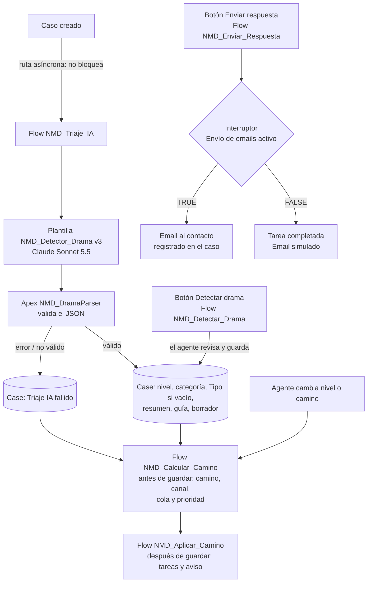

# Demo 2 — Triaje NMD: IA que detecta, reglas que deciden, personas que actúan

> Proyecto de portfolio. No More Drama (NMD) es una marca ficticia y todos los datos de demo son inventados.

## 1. Problema de negocio

En la consola NMD Care entran decenas de casos al día. Algunos son una consulta tranquila; otros, un cliente a punto de irse o un riesgo de seguridad. Si todos esperan en la misma cola, los urgentes se pierden entre los rutinarios y las respuestas se escriben en caliente.

## 2. Solución: tres pasos con responsables distintos

| Paso | Quién decide | Qué pasa |
|---|---|---|
| **1. Detectar** | **IA** (Claude Sonnet 5.5 con Prompt Builder) | Al crearse un caso, en segundo plano, propone nivel de drama 1-5, categoría, resumen, guía para el agente y, para niveles 1-2, un borrador de email |
| **2. Decidir** | **Reglas en Flow** (no la IA) | Según el nivel: camino, cola, prioridad, canal recomendado, tarea y aviso al supervisor |
| **3. Actuar** | **La persona** | Revisa, cambia nivel o camino si no está de acuerdo (queda en el historial), reanaliza con **Detectar drama** y responde con **Enviar respuesta** |

**La IA nunca decide la ruta ni envía nada.** Propone; las reglas, que son visibles y auditables, deciden, y el agente tiene la última palabra.

### Reglas del paso 2

| Nivel | Camino | Cola | Prioridad | Tarea (al agente de guardia) | Canal recomendado | Aviso |
|---|---|---|---|---|---|---|
| 5 | **Urgente** | Urgencias NMD | High | "Llamar al cliente en 2 h" (hoy, recordatorio a las 2 h) | Llamada urgente | 🔔 Notificación al supervisor |
| 3-4, o IA fallida | **Contactar hoy** | Agentes NMD | sin cambios | "Contactar hoy" | Llamada | — |
| 1-2 | **Respuesta escrita** | Agentes NMD | sin cambios | — | Respuesta por escrito en 48 h | — |

- **IA fallida:** si la plantilla da error o la respuesta no es válida (JSON roto, categoría desconocida, falta el borrador en nivel 1-2...), el caso se marca **Triaje IA fallido** y va a *Contactar hoy*.
- **Escalados del Agente Zen** (Origen = Agente Zen, asunto "Escalado desde el Agente Zen"): como mínimo *Contactar hoy*, porque el cliente ya pidió hablar con una persona.
- **Cambios del agente:** si cambia el **nivel** (o un caso tiene nivel pero aún no tiene camino), las reglas calculan el camino. Si cambia el **camino** a mano, se respeta y se aplican su cola, prioridad, canal y tarea. Todo queda en el **historial de campos** del caso (nivel, camino, canal, triaje fallido, propietario y prioridad).
- Una tarea no puede pertenecer a una cola, por eso las tareas se asignan al **agente de guardia** de la configuración.

## 3. Arquitectura



| Pieza | API name | Qué hace |
|---|---|---|
| Plantilla de Prompt Builder | `NMD_Detector_Drama` (Flex, versión 3) | Recibe el caso (asunto, descripción, tipo, prioridad, origen, contacto y pedido con su estado) y devuelve un JSON `{nivel, categoria, resumen, guia[], borrador}`. Incluye la lista de lo que NMD puede ofrecer, para que ni la guía ni el borrador prometan nada más |
| Apex | `NMD_DramaParser` + `NMD_DramaParserTest` | Acción invocable que valida y normaliza el JSON: nivel 1-5, categoría en la lista, guía en viñetas, borrador obligatorio solo en niveles 1-2 y textos recortados. No llama al modelo. 6 tests, 100 % de cobertura |
| Flow (al crear, asíncrono) | `NMD_Triaje_IA` | Paso 1: llama a la plantilla y guarda la propuesta, o marca el fallo |
| Flow (antes de guardar) | `NMD_Calcular_Camino` | Paso 2: reglas de camino, canal, cola y prioridad. Sin DML: rápido y sin bucles |
| Flow (después de guardar) | `NMD_Aplicar_Camino` | Paso 2: tareas y notificación. Si algo falla aquí, no deshace el caso |
| Flow de pantalla | `NMD_Detectar_Drama` | Botón **Detectar drama**: reanaliza y deja editar la propuesta antes de guardarla |
| Flow de pantalla | `NMD_Enviar_Respuesta` | Botón **Enviar respuesta**: solo para niveles 1-2 (en el resto avisa "requiere contacto directo" y no envía nada) |
| Campos de Case | `Nivel_drama__c`, `Categoria_IA__c`, `Resumen_IA__c`, `Guia_agente__c`, `Respuesta_sugerida__c` (etiqueta "Borrador de email"), `Camino__c`, `Canal_recomendado__c`, `Triaje_IA_fallido__c`, `Triaje_IA_fecha__c` | Con historial en nivel, camino, canal y triaje fallido |
| Configuración | `NMD_Config__mdt`, registro `General` | `Envio_emails_activo__c`, `Supervisor__c` y `Agente_de_guardia__c` (usernames) |
| Cola | `Urgencias_NMD` | Casos de nivel 5 |
| Notificación | `Urgencia_NMD` | Campana del supervisor |
| Vistas de Case | `Urgencias_NMD`, `Cola_por_drama` | Casos abiertos de la cola de urgencias; todos los casos abiertos triados (ordénala por *Nivel de drama* descendente: el orden de una vista es una preferencia de cada usuario y no viaja en los metadatos) |
| Página y diseño | `NMD_Caso` (FlexiPage), `Case-NMD Caso` (diseño de página) | Cabecera con acciones dinámicas (Detectar drama, Enviar respuesta, Aceptar, Cambiar propietario, Modificar...), pestañas Noticias, Detalles y Relacionado. En Detalles, con Dynamic Forms: sección **Triaje NMD** en 2 columnas (Drama, Nivel de drama, Camino · Canal recomendado, Categoría IA), sección **Análisis de la IA** a ancho completo (Resumen IA y Guía en solo lectura; *Borrador de email* solo si Camino = Respuesta escrita; *Triaje IA fallido* solo si está marcado) y acordeón plegado **Detalles técnicos** (Fecha triaje IA). El solo lectura de Dynamic Forms no se aplica a perfiles con *Editar campos de solo lectura* (administradores) |
| Permisos | `NMD_Base` | Campos, flows, clase Apex, lectura de la configuración y **Ejecutar flujos** (el perfil Usuario estándar de esta org no lo tiene, y sin él los botones de Flow no aparecen). El permiso de Salesforce para ejecutar plantillas (`EinsteinGPTPromptTemplateUser`) se asigna aparte porque tiene licencia propia |

## 4. El interruptor de envío de emails

**Configuración → Tipos de metadatos personalizados → Configuración NMD → Administrar registros → General → Envío de emails activo.**

| Valor | Qué hace **Enviar respuesta** |
|---|---|
| **FALSE** (valor de la demo) | **No envía nada.** Crea en el caso una tarea completada *Email simulado: <asunto>* (subtipo Email, vinculada al contacto) con destinatario, asunto y el texto final. Así la demo enseña el flujo completo sin escribir a nadie |
| **TRUE** | Envía el email al contacto del caso (acción estándar *Enviar email*) y lo registra en el caso |

En los dos casos el texto final que aprobó el agente se guarda en *Borrador de email*. Al ser Custom Metadata, el valor viaja con los despliegues: en una org nueva llega **apagado** salvo que se cambie a propósito. Antes de encenderlo en una org real, revisa la entrega de emails de la org y que los contactos tengan direcciones reales.

## 5. Elección del modelo

En nmd-dev, Prompt Builder ofrece 67 modelos estándar (OpenAI, Anthropic, Google, Amazon y NVIDIA) y ningún modelo personalizado, porque traer tu propio modelo requiere Data Cloud y Einstein Studio. Usamos **Claude Sonnet 5.5** (`sfdc_ai__DefaultBedrockAnthropicClaude55Sonnet`) por su calidad en español, cómo sigue reglas y tono y la fiabilidad del JSON.

## 6. IA responsable

- **Separación de responsabilidades:** la IA clasifica y redacta; las reglas, que son deterministas y están en Flow, enrutan; el agente decide y puede corregir todo.
- **Fallo seguro:** si la IA falla, el caso no se queda sin atender: va a *Contactar hoy* marcado como fallido.
- **Nada sale sin una persona:** el borrador solo se envía con el botón y tras revisión. Además, el interruptor de envío está apagado.
- **Sin promesas falsas:** la plantilla incluye explícitamente lo que NMD puede ofrecer y prohíbe reembolsos, compensaciones, descuentos o fechas.
- **Datos como datos:** el texto del cliente se trata como información, no como instrucciones.
- **Trazabilidad:** fecha del triaje IA, historial de campos y actividades (tareas y emails simulados) en el caso.
- **Trust Layer:** las llamadas pasan por la Einstein Trust Layer de Salesforce (retención cero en el proveedor del modelo; el enmascarado de datos depende de la configuración de la org).

### Lecciones aprendidas

- **Acciones rápidas en la cabecera del Caso:** con la cabecera estándar (`force:highlightsPanel`) y un diseño de página basado en noticias, Lightning pone las acciones rápidas en el publicador de noticias, no en la cabecera. Solución: cabecera con acciones dinámicas (`record_flexipage:dynamicHighlights`) y lista explícita de acciones. Limitación: esa cabecera no muestra el botón *Seguir*.
- **Un diseño de página basado en noticias no deja de serlo por metadatos.** Quitar `feedLayout` del XML no cambia nada en la org. Por eso hay un diseño nuevo, `Case-NMD Caso`, asignado a los perfiles Administrador del sistema y Usuario estándar (`profiles/Admin` y `profiles/Standard` solo llevan esa asignación).
- **Caché del navegador:** Lightning guarda en caché páginas y acciones. Tras desplegar cambios de página o de diseño, puede hacer falta cerrar sesión y volver a entrar (o vaciar el almacenamiento del sitio) para verlos.
- **Ruta asíncrona sin etiqueta:** en un Flow desencadenado por registro, la ruta `AsyncAfterCommit` no admite `label`.
- **Versiones de la plantilla:** una versión publicada no se puede modificar; para cambiar el texto se sube el sufijo de `versionIdentifier` y `activeVersionIdentifier` (ahora `_3`).
- **Botones de Flow invisibles para un usuario:** si el perfil no tiene *Ejecutar flujos* (`RunFlow`), dar acceso a Flows concretos desde un permission set no basta; las acciones rápidas de Flow ni siquiera aparecen. Se añadió `RunFlow` a NMD Base.
- **Reglas que dependen de "cambió":** los casos que ya tenían nivel de la primera versión de la demo no cambiaron de nivel al reanalizarlos y se quedaron sin camino. Ahora las reglas también se aplican a casos con nivel y sin camino.
- **Vista dividida:** en la consola, la vista dividida solo ordena por los campos que muestra; para ordenar *Cola por drama* por nivel, cambia a vista de tabla.
- **El idioma es del usuario, no de la página.** `data/nmd-agente-humano.apex` deja al Agente Humano en español.

## 7. Cómo desplegarla en otra org

Requisitos: Einstein generativo activado y la Demo 1 desplegada (app NMD Care, cola Agentes NMD, `Case.Pedido__c`, campos de Order y `NMD_Base`).

1. En `customMetadata/NMD_Config.General.md-meta.xml`, cambia `Supervisor__c` y `Agente_de_guardia__c` por usernames de la org destino (deja `Envio_emails_activo__c` en `false`).
2. Despliega en este orden:

```bash
D=force-app/main/default
# Campos, configuración, cola y notificación
sf project deploy start -d $D/objects/Case/fields -d $D/objects/Case/validationRules -d $D/objects/NMD_Config__mdt \
  -d $D/customMetadata -d $D/queues/Urgencias_NMD.queue-meta.xml -d $D/notificationtypes --target-org <alias>
# Apex con tests y plantilla
sf project deploy start -d $D/classes --test-level RunSpecifiedTests --tests NMD_DramaParserTest --target-org <alias>
sf project deploy start -d $D/genAiPromptTemplates --target-org <alias>
# Flows, acciones, diseño, página, perfiles, app, permisos y vistas
sf project deploy start -d $D/flows/NMD_Triaje_IA.flow-meta.xml -d $D/flows/NMD_Calcular_Camino.flow-meta.xml \
  -d $D/flows/NMD_Aplicar_Camino.flow-meta.xml -d $D/flows/NMD_Detectar_Drama.flow-meta.xml \
  -d $D/flows/NMD_Enviar_Respuesta.flow-meta.xml -d $D/quickActions -d "$D/layouts/Case-NMD Caso.layout-meta.xml" \
  -d $D/profiles -d $D/flexipages/NMD_Caso.flexipage-meta.xml -d $D/applications \
  -d $D/permissionsets/NMD_Base.permissionset-meta.xml -d $D/objects/Case/listViews --target-org <alias>
# Agente humano: permisos, colas e idioma
sf apex run --file data/nmd-agente-humano.apex --target-org <alias>
```

3. Si cargas los datos de demo (`data/nmd-demo-data.apex`) después, **cada caso nuevo lanza el triaje automático** (una llamada a la IA por caso). Si los casos ya existían, lanza una vez `data/nmd-triaje-inicial.apex` (ver `data/README.md`).

## 8. Pruebas realizadas (nmd-dev)

### 8.1 Tests unitarios

`NMD_DramaParserTest`: 6 tests, 100 % de cobertura. Cubren niveles altos sin borrador, niveles bajos con borrador, JSON envuelto en texto, guía como texto o como lista, niveles fuera de rango o decimales, textos largos y 13 respuestas inválidas.

### 8.2 Casos nuevos de punta a punta (borrados después)

| Caso de prueba | IA | Reglas | Resultado |
|---|---|---|---|
| Cargador quemado, amenaza con redes y consumo | Nivel 5, Producto defectuoso, sin borrador | Urgente | Cola Urgencias NMD, High, tarea "Llamar al cliente en 2 h" con recordatorio, notificación en la campana del supervisor |
| Tapones sueltos en una caja de IPA | Nivel 3, Producto defectuoso | Contactar hoy | Cola Agentes NMD, tarea "Contactar hoy", canal Llamada |
| Reenvío de factura | Nivel 1, Consulta de pedido, con borrador | Respuesta escrita | Cola Agentes NMD, sin tarea, canal escrito 48 h. **Enviar respuesta** (editado por el agente) → tarea *Email simulado* con el texto final |
| Escalado de Zen por una duda de factura | Nivel 1 | Mínimo para Zen | Contactar hoy (no respuesta escrita) |
| IA fallida (simulada marcando el fallo) | — | Contactar hoy | Canal Llamada, tarea "Contactar hoy" |
| Agente cambia el camino a Urgente a mano | — | Se respeta | Cola Urgencias NMD, High, tarea y aviso; todo en el historial |

El caso de IA fallida se simuló actualizando el caso igual que lo hace el Flow cuando falla (`Triaje_IA_fallido__c = true`). El rechazo de respuestas inválidas está cubierto por los tests unitarios.

### 8.3 Comprobación en el navegador (consola NMD Care)

| Usuario | Comprobado |
|---|---|
| Carol (administradora y supervisora) | Cabecera con Detectar drama, Enviar respuesta, Aceptar, Cambiar propietario, Modificar y Registrar una llamada; pestaña Noticias; sección Triaje NMD; campana con las notificaciones de urgencia; Enviar respuesta en un caso de nivel 1 (texto editado) → actividad *Email simulado*; vistas Urgencias NMD y Cola por drama |
| Agente Humano NMD | Interfaz en español; mismos botones (después de añadir *Ejecutar flujos*); Enviar respuesta en un caso de nivel 5 → "Este caso requiere contacto directo", sin enviar nada; Detectar drama analiza con la IA y Descartar no guarda nada; sección Triaje NMD visible; Cola por drama ordenada por nivel en vista de tabla |

### 8.4 Triaje inicial de los casos de la demo

Se lanzó una vez sobre los 15 casos abiertos (11 de los datos de demo y 4 creados por Zen): 15 llamadas a la IA, ninguna fallida. Resultado: 2 Urgente (nivel 5), 7 Contactar hoy (niveles 3-4 y un escalado de Zen de nivel 2) y 6 Respuesta escrita (niveles 1-2).
