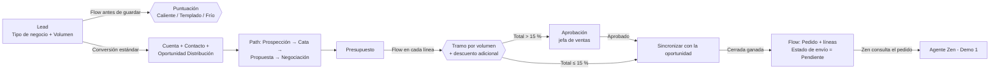

# Demo 3 — NMD Distribución: ventas B2B de lead a pedido

> Proyecto de portfolio. No More Drama (NMD) es una marca ficticia y todos los datos de demo son inventados.

## 1. Historia

NMD Distribución vende las cervezas NMD (línea Beverage) a bares, restaurantes, festivales y distribuidores. El comercial califica leads, los convierte, hace catas y presupuestos con descuento por volumen; la jefa de ventas aprueba los descuentos altos y, al ganar la venta, **se crea el pedido** que después consulta el agente Zen (Demo 1).

## 2. Usuarios

| Usuario | Papel | Cómo se crea |
|---|---|---|
| **Comercial NMD** | Lleva leads, oportunidades y presupuestos | `data/nmd-comercial.apex`: licencia Salesforce, perfil Usuario estándar, es / es_ES, **Manager = jefa de ventas**, permission set `NMD_Ventas` |
| **Jefa de ventas** (usuaria administradora) | Aprueba descuentos > 15 %, ve el dashboard | El mismo script le asigna `NMD_Ventas` |

## 3. Proceso de lead a pedido



### 3.1 Puntuación de leads (`NMD_Puntuar_Lead`, antes de guardar)

| Puntuación | Regla |
|---|---|
| Caliente | 100 o más cajas/mes, o Festival/Distribuidor con 50 o más |
| Templado | 30–99 cajas/mes |
| Frío | menos de 30 o sin volumen |

Los leads con origen **Club Drama Points** (consumidores que se apuntan al club en el portal de la Demo 5) no se puntúan: no son negocios.

Al convertir, el **Tipo de negocio** pasa a la cuenta (mapeo de campos de conversión, `LeadConvertSettings`).

### 3.2 Proceso de ventas propio

Tipo de registro de oportunidad **Distribución** con el proceso de ventas `Proceso_NMD_Distribucion`: **Prospección (10 %) → Cata (30 %) → Propuesta (60 %) → Negociación (80 %) → Cerrada ganada / Cerrada perdida**. Las etapas estándar de Salesforce siguen intactas para otros procesos. Es el tipo de registro por defecto de los perfiles Administrador del sistema y Usuario estándar, así que las conversiones de leads crean oportunidades Distribución.

**Path** `Ventas_NMD_Distribucion` con campos clave y una guía por etapa (qué conseguir, qué llevar a la cata, cuándo pedir aprobación…).

### 3.3 Presupuestos con descuento por volumen

`NMD_Descuento_Volumen` (al crear o cambiar líneas) y `NMD_Descuento_Volumen_Borrado` (antes de borrar una línea) llaman al subflow `NMD_Recalcular_Presupuesto`, que suma las cajas de todas las líneas y aplica a cada una **Descuento = tramo + Descuento adicional** (máximo 100 %):

| Cajas del presupuesto | Tramo |
|---|---|
| menos de 50 | 0 % |
| 50–149 | 5 % |
| 150–299 | 10 % |
| 300 o más | 15 % |

El presupuesto muestra **Cajas totales** y **Descuento por volumen**. El descuento adicional lo pone el comercial en cada línea.

### 3.4 Aprobación de descuentos (`NMD_Descuento_mayor_15`)

- **Entrada:** descuento total del presupuesto (`Quote.Discount`) > 15 %. Con el tramo máximo (15 %) nunca hace falta; solo cuando se añade descuento extra.
- **Aprobador:** el **Manager** del propietario (la jefa de ventas), con la solicitud en su campana.
- **Acciones:** al enviar, Estado = En revisión y registro bloqueado; al aprobar, Estado = Aprobado y *Descuento aprobado* = sí; al rechazar, Estado = Rechazado.
- **Regla de validación** `NMD_Descuento_requiere_aprobacion`: un presupuesto con más del 15 % no puede pasar a Presentado o Aceptado sin aprobación.

### 3.5 Ganada → Pedido (`NMD_Pedido_Desde_Oportunidad`)

Cuando una oportunidad pasa a **Cerrada ganada** con un presupuesto **sincronizado**, crea el pedido con: cuenta, **contacto de facturación = contacto del presupuesto** (lo que Zen usa para verificar), Price Book, estado Borrador, **Estado de envío = Pendiente**, entrega prevista a 5 días hábiles, enlaces `Oportunidad__c` y `Presupuesto__c`, y una línea por cada línea del presupuesto con el **precio ya descontado**. No crea un segundo pedido si la oportunidad ya tiene uno.

**El pedido cuadra al céntimo con el presupuesto.** El precio unitario de una línea de pedido solo admite 2 decimales. Si el precio con descuento no es exacto (por ejemplo 1,90 × 0,85 = 1,615), el Flow divide la línea: *(cantidad − 1)* unidades al precio redondeado hacia abajo y **1 unidad de ajuste** con el resto. Ejemplo probado: 150 × 1,90 − 15 % = 242,25 → 149 × 1,61 + 1 × 2,36 = 242,25. Con los productos por caja (precios en euros enteros) y descuentos enteros, el precio siempre es exacto y no hace falta dividir.

## 4. Productos por caja

NMD Distribución vende **cajas de 24 botellas** (familia *Caja 24*), creadas por `data/nmd-ventas-demo.apex` en el Standard Price Book. Los productos por botella de la Demo 1 (`NMD-BEV-001…004`) no se tocan.

| Código | Producto | Precio (caja) |
|---|---|---|
| NMD-BEV-101 | Caja Lager Zen (24 x 33 cl) | 36 € |
| NMD-BEV-102 | Caja IPA Sin Drama (24 x 33 cl) | 42 € |
| NMD-BEV-103 | Caja Stout Plan B (24 x 33 cl) | 45 € |
| NMD-BEV-104 | Caja Radler Todo Bien (24 x 33 cl) | 33 € |

La moneda de la org es el **euro** (configuración regional de divisa *Español (España) - EUR*, sin multidivisa).

## 5. App, página de inicio y dashboard

- **App NMD Distribución** (navegación estándar): Inicio, Leads (Candidatos), Cuentas, Contactos, Oportunidades, Presupuestos, Pedidos, Informes y Dashboards (Paneles). Color `#62058A`, logo `NMD_Icono`.
- **Página de inicio** `NMD_Inicio_Distribucion` (marca NMD): pipeline por etapa, **presupuestos pendientes de mi aprobación** (componente *Elementos para aprobar*), **leads calientes** (vista `Leads_calientes`) y **ventas del mes por producto**. Informes en la carpeta **NMD**.
- **Dashboard "Ventas NMD"** (carpeta de dashboards *NMD Distribución*; sus informes están en la carpeta **NMD**; se ejecuta como la jefa de ventas): pipeline por etapa, ventas por producto, top 5 clientes y conversión de leads. Informes: `NMD_Pipeline_por_etapa`, `NMD_Ventas_por_producto`, `NMD_Top_clientes`, `NMD_Conversion_de_leads`.

## 6. Datos de demo

`data/nmd-ventas-demo.apex` (idempotente, unos 45 registros; lo ejecuta la jefa de ventas después de `nmd-demo-data.apex` y `nmd-comercial.apex`):

| Qué | Detalle |
|---|---|
| 10 leads | Bares, restaurantes, festivales y distribuidores: 4 Caliente, 3 Templado, 3 Frío. 3 convertidos |
| 6 oportunidades | Prospección, Cata, Propuesta, Negociación, Cerrada ganada y Cerrada perdida |
| 3 presupuestos (productos por caja) | Gastrobar Sin Prisas: 60 cajas, 5 %, 2.166 €, presentado · Festival Norte Tranquilo: 160 cajas, 10 % + 8 % = **18 %, 4.477,20 €, pendiente de aprobación** · Taberna El Respiro: 320 cajas, 15 %, 10.608 €, aceptado y sincronizado |
| 1 pedido | Creado por el Flow al ganar Taberna El Respiro: 10.608 €, igual que el presupuesto. Estado de envío Pendiente. Zen lo consulta con el número de pedido y `antonio.vega@example.com` |

Para borrarlos: `data/nmd-ventas-cleanup.apex` (retira la aprobación pendiente y borra pedidos, oportunidades con presupuestos, cuentas convertidas y leads).

## 7. Seguridad y permisos

- **`NMD_Ventas`** (permission set nuevo, separado de `NMD_Base` de servicio): app, acceso a Leads, Cuentas, Contactos, Oportunidades, Presupuestos y Pedidos, campos nuevos (los calculados en solo lectura), tipo de registro Distribución, pestañas y **Ejecutar flujos** (lección de la Demo 2: sin él, los usuarios estándar no ejecutan Flows).
- Los Flows desencadenados por registro se ejecutan en contexto de sistema; las reglas (tramos, aprobación, pedido) no dependen de que el comercial pueda editar campos calculados.

## 8. Pruebas realizadas (nmd-dev)

**Con rollback (script de pruebas):** puntuación en los límites (20, 30, 99, 100, Festival 49/50, Distribuidor 60, sin volumen y cambio de 20 a 150); tramos en 49/50, 149/150, 299/300; descuento adicional (17,79 %); borrar una línea (recalcula); validación que bloquea "Presentado" sin aprobación; envío, aprobación y estados; ganar → 1 pedido con líneas; volver a ganar → sigue habiendo 1 pedido.

**Redondeo (con rollback):** 150 × 1,90 − 15 % = 242,25 → el pedido divide la línea (149 × 1,61 + 1 × 2,36) y el total cuadra (573,75 = 573,75).

**Páginas de inicio (navegador):** jefa de ventas (pipeline, ventas del mes, el presupuesto pendiente en *Elementos para aprobar*, leads calientes) y Comercial NMD (la misma página; *Elementos para aprobar* vacío; importes en €, p. ej. 10.608,00 €).

**En el navegador:**

| Usuario | Comprobado |
|---|---|
| Jefa de ventas | App con sus pestañas y marca; dashboard con los 4 gráficos; solicitud de aprobación en la campana con cajas, tramo y descuento; **Aprobar** → Estado Aprobado |
| Comercial NMD | Interfaz en español; crear lead (Festival, 70 cajas → **Caliente**); **Convertir** (cuenta con Tipo de negocio, oportunidad Distribución en Prospección); Path con guía; pasar a Propuesta; crear presupuesto desde la oportunidad; añadir productos (100 + 60 cajas → 10 % automático); descuento adicional 10 % → 16,51 %; **Enviar para aprobación** → En revisión |

Después, la oportunidad de prueba se ganó y el Flow creó su pedido (Pendiente, 2 líneas); todos los registros de prueba se borraron.

## 9. Limitaciones y decisiones

- **Línea de ajuste en el pedido:** cuando el precio con descuento no es exacto a céntimos, el pedido lleva una línea de 1 unidad con el ajuste (ver 3.5). Es la única forma de cuadrar al céntimo con 2 decimales por precio unitario.
- **`Order.OpportunityId` / `QuoteId` no existen en esta org**, por eso hay búsquedas personalizadas `Order.Oportunidad__c` y `Order.Presupuesto__c`.
- **Estados del presupuesto en español:** al activar Quotes, la org creó los valores con nombre de API en español (Borrador, En revisión, Aprobado…); las acciones de aprobación y la validación usan esos valores.
- **Diseños de página:** Lead, Cuenta y Línea de presupuesto tienen una sección *NMD Distribución* con los campos nuevos. El botón *Enviar para aprobación* del Presupuesto se habilitó. Además:
  - **Oportunidad Distribución:** diseño propio `Opportunity-NMD Distribucion` (asignado al tipo de registro en Administrador y Usuario estándar): *Oportunidad* (nombre, cuenta, importe, cierre · propietario, etapa, probabilidad, siguiente paso), *Descripción*, *Sistema*; listas Presupuestos, Pedidos NMD, Productos, Funciones de contactos, Actividad, Historial de la etapa y Notas. Sin los campos de la plantilla de ejemplo (generadores, competidores, campaña…).
  - **Presupuesto:** *Presupuesto* (nombre, número, oportunidad, cuenta, contacto · estado, caducidad, sincronizando), *Importes y descuento* (subtotal, descuento, total · cajas, tramo, descuento aprobado), *Descripción*, *Sistema*; listas Partidas, Pedidos NMD, Historial de aprobaciones, PDF, Actividad y Notas. Sin impuestos, envío, direcciones ni fax (vacíos).
  - **Pedido:** *Pedido* (número, cuenta, contacto de facturación, oportunidad, presupuesto · estado, fecha, importe, propietario), *Envío* (estado y fecha prevista), *Descripción*, *Sistema*; listas Productos de pedido, **Casos NMD**, Actividad, Historial y Notas. Sin autorizaciones, contrato, tipo ni direcciones (vacíos).
- **Dashboard:** se ejecuta como la jefa de ventas (`runningUser` en el XML); en otra org hay que cambiar ese username.
- **Moneda:** el cambio a euros se hizo en *Configuración → Información de la compañía → Configuración regional de divisa*; no se despliega por metadata.

## 10. Cómo desplegarla en otra org

```bash
D=force-app/main/default
sf project deploy start -d $D/settings/Quote.settings-meta.xml -d $D/settings/PathAssistant.settings-meta.xml --target-org <alias>
sf project deploy start -d $D/standardValueSets/OpportunityStage.standardValueSet-meta.xml --target-org <alias>   # reemplaza la lista: revisa antes
sf project deploy start -d $D/objects/Opportunity -d $D/objects/Lead -d $D/objects/Account/fields/Tipo_de_negocio__c.field-meta.xml \
  -d $D/objects/Quote -d $D/objects/QuoteLineItem -d $D/objects/Order/fields -d $D/profiles -d $D/LeadConvertSettings --target-org <alias>
sf project deploy start -d $D/pathAssistants -d $D/flows/NMD_Puntuar_Lead.flow-meta.xml -d $D/flows/NMD_Recalcular_Presupuesto.flow-meta.xml \
  -d $D/flows/NMD_Descuento_Volumen.flow-meta.xml -d $D/flows/NMD_Descuento_Volumen_Borrado.flow-meta.xml \
  -d $D/flows/NMD_Pedido_Desde_Oportunidad.flow-meta.xml -d $D/workflows/Quote.workflow-meta.xml -d $D/approvalProcesses --target-org <alias>
sf project deploy start -d $D/applications/NMD_Distribucion.app-meta.xml -d $D/permissionsets/NMD_Ventas.permissionset-meta.xml \
  -d $D/layouts -d $D/reports -d $D/dashboards -d $D/objects/Lead/listViews \n  -d $D/flexipages/NMD_Inicio_Distribucion.flexipage-meta.xml --target-org <alias>
sf apex run --file data/nmd-comercial.apex --target-org <alias>
sf apex run --file data/nmd-ventas-demo.apex --target-org <alias>
```

Antes de desplegar `OpportunityStage` en otra org, recupera su lista actual y añade las etapas NMD: desplegar un conjunto de valores estándar reemplaza la lista completa.
