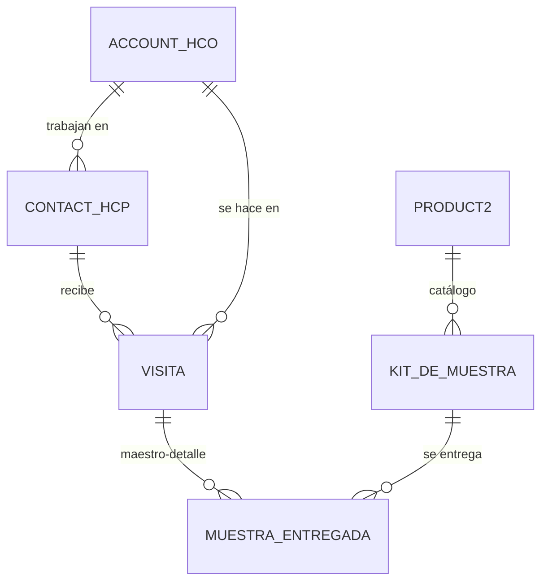
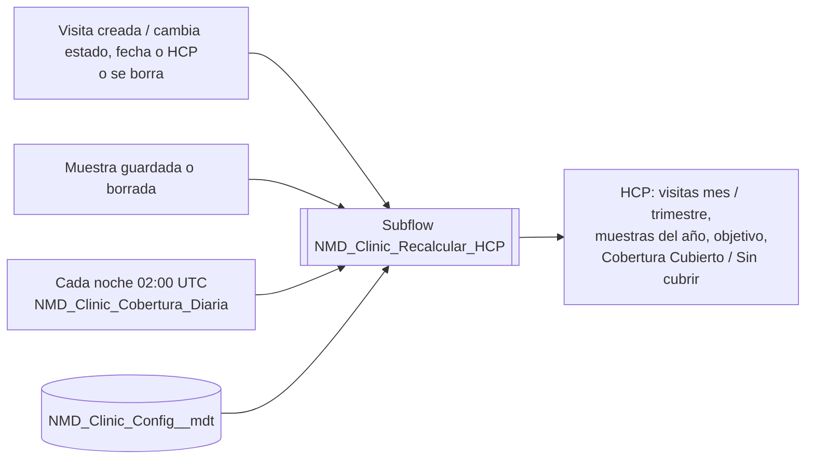

# Demo 4 — NMD Clinic: visita médica y compliance

> Proyecto de portfolio. No More Drama (NMD) es una marca ficticia y todos los datos de demo (centros, profesionales, colegiados) son inventados.

## 1. Historia

NMD Clinic Labs vende kits de detox digital (los productos Clinic `NMD-CLI-001` y `NMD-CLI-002`) a través de psicólogos, psiquiatras y clínicas. Una **delegada de visita médica** visita a los profesionales sanitarios (**HCP**) en sus centros (**HCO**), registra cada visita (*call report*) y entrega kits de muestra.

Es un sector regulado, así que el sistema obliga a cumplir tres reglas:

- **Sin consentimiento RGPD no hay visita realizada ni muestras.**
- **Hay un límite anual de muestras por HCP** (10, configurable).
- **Las muestras solo se entregan en visitas realizadas.**

La jefa de compliance y ventas sigue la **cobertura del call plan**, es decir, si cada HCP recibe las visitas que le tocan según su segmento.

## 2. Usuarios

| Usuario | Papel | Cómo se crea |
|---|---|---|
| **Delegada NMD Clinic** | Visita a los HCP, registra visitas y muestras y usa "Prepara mi visita" | `data/nmd-delegada.apex`: **licencia Salesforce Platform**, perfil "Usuario de Platform estándar", es / es_ES, rol *Delegada NMD Clinic*, Manager = jefa. Permission sets `NMD_Clinic` y *Prompt Template User* |
| **Jefa de compliance y ventas** (usuaria administradora) | Ve todas las visitas, el dashboard y la configuración | El mismo script le pone el rol *Jefa de compliance y ventas* y `NMD_Clinic` |

**Visibilidad:** `Visita__c` es **privado**. La delegada ve solo sus visitas, y la jefa las ve todas porque su rol está por encima en la jerarquía. Las muestras siguen a su visita (maestro-detalle), y el catálogo de kits es de solo lectura.

**Por qué la licencia Platform:** es la licencia barata para usuarios que trabajan con objetos propios, cuentas y contactos. Su límite es que **no da acceso a Productos (`Product2`)**. Por eso existe el catálogo **Kit de muestra**, que enlaza con el producto Clinic: la delegada elige el kit y la jefa ve de qué producto sale.

## 3. Modelo de datos



| Objeto | Qué es | Campos clave |
|---|---|---|
| **Cuenta**, tipo de registro **HCO** | Clínica, consulta, centro de salud u hospital | Tipo de centro |
| **Contacto**, tipo de registro **HCP** | Profesional sanitario | Especialidad, Nº de colegiado (único), **Segmento A/B/C**, **Consentimiento RGPD** + fecha (obligatoria si hay consentimiento). Calculados: visitas del mes/trimestre, muestras del año, muestras disponibles, objetivo, **Cobertura** |
| **Visita** (`Visita__c`, V-0001) | Call report | HCP, HCO, Fecha, Hora, **Estado** (Planificada / Realizada / Cancelada), Objetivo, Resultado, Siguiente paso, Preparación IA |
| **Muestra entregada** (`Muestra_entregada__c`, M-0001) | Sample management | Visita (maestro), Kit, Cantidad; HCP y Fecha de entrega se copian de la visita |
| **Kit de muestra** (`Kit_de_muestra__c`) | Catálogo de kits entregables | Código, Activo, Producto (`Product2`, solo lo ve la jefa) |
| **Configuración NMD Clinic** (`NMD_Clinic_Config__mdt.General`) | Reglas configurables sin desplegar código | Límite anual de muestras = 10; objetivos A = 2/mes, B = 1/mes, C = 1/trimestre |

Los tipos de registro **Cliente** (Cuenta) y **Contacto** (Contacto) son los de por defecto de los perfiles Administrador y Usuario estándar, así que las demos anteriores no cambian. El perfil de Platform usa HCO y HCP por defecto.

## 4. Compliance: los bloqueos

| Regla | Dónde | Mensaje |
|---|---|---|
| Una visita solo puede ser **Realizada** si el HCP tiene consentimiento | Regla de validación `NMD_Consentimiento_para_realizar` (Visita) | *No se puede registrar la visita como realizada: el HCP no ha dado su consentimiento RGPD.* |
| **Sin muestras para un HCP sin consentimiento** | Regla de validación `NMD_Muestra_requiere_consentimiento` | *No se pueden entregar muestras: el HCP no ha dado su consentimiento RGPD.* |
| **Muestras solo en visitas realizadas** | Regla de validación `NMD_Muestra_solo_visita_realizada` | *Solo se pueden registrar muestras en una visita Realizada.* |
| **Límite anual de muestras por HCP** | Flow antes de guardar `NMD_Clinic_Muestra_Limite` (error personalizado) | *Límite anual de muestras superado: Lucía Herrera lleva 9 de 10 kits este año y esta entrega de 2 lo supera. Puedes entregar como máximo 1.* |
| Fecha de consentimiento obligatoria | Regla de validación `NMD_Fecha_consentimiento_obligatoria` (Contacto) | *Indica la fecha en que el HCP dio su consentimiento RGPD.* |

El Flow del límite se ejecuta antes que las reglas de validación. Por eso solo comprueba el límite cuando la visita está Realizada y el HCP tiene consentimiento. En los demás casos deja que las reglas den su mensaje, que es más útil.

## 5. Call plan y cobertura



| Segmento | Objetivo | Cubierto si… |
|---|---|---|
| A | 2 visitas al mes | 2 o más visitas **realizadas** este mes |
| B | 1 visita al mes | 1 o más este mes |
| C | 1 visita al trimestre | 1 o más este trimestre natural |

El recálculo nocturno existe porque la cobertura depende del mes y del trimestre en curso: el día 1 un HCP "Cubierto" puede pasar a "Sin cubrir" aunque nadie toque sus visitas. Al borrar una visita o una muestra, el Flow "antes de borrar" recalcula excluyendo ese registro.

**Vistas:** *HCP sin cubrir*, *Mis HCP*, *HCP cerca del límite de muestras* (2 o menos disponibles), *HCP sin consentimiento RGPD*, *Visitas de hoy*, *Próximas visitas*, *Visitas realizadas este mes* y *Muestras entregadas este año*.

## 6. "Prepara mi visita" (IA)

Botón en la visita → Flow de pantalla `NMD_Clinic_Prepara_Visita`:

1. La acción Apex `NMD_ContextoVisita` (**with sharing**) reúne en texto el HCP, el segmento, la cobertura, el consentimiento, las muestras del año frente al límite, las 3 últimas visitas realizadas y las últimas muestras. Lo guarda en el campo técnico `Contexto_IA__c`.
2. La plantilla de Prompt Builder **`NMD_Prepara_Visita`** (Flex, **Claude Sonnet 5.5**) devuelve en texto plano cuatro apartados: *Resumen del HCP*, *Últimas visitas*, *Muestras* y *Temas a tratar*.
3. La delegada **revisa y edita** el texto y decide si lo guarda en *Preparación IA* o solo lo consulta.

Reglas de la plantilla: **no da consejo médico, terapéutico ni diagnóstico**, no recomienda el kit para pacientes concretos, no promete descuentos ni contraprestaciones, avisa si falta el consentimiento y no propone muestras si no quedan. Trata los datos como información, no como instrucciones, y no se inventa lo que falta.

> **Por qué un campo intermedio y no un campo de combinación Apex.** La plantilla no admitió la acción Apex como recurso: los `CapabilityType` `PromptTemplateType://einstein_gpt__flex` y `FlexTemplate://NMD_Prepara_Visita` dan "isn't available" en esta org. Con el campo intermedio, además, se puede auditar exactamente qué datos recibió la IA (pestaña *Detalles técnicos* de la visita).

## 7. Interfaz

- **App NMD Clinic** (cabecera #62058A, logo NMD), con estas pestañas: Inicio, Visitas, Contactos, Cuentas, Muestras entregadas, Kits de muestra, Informes y Paneles. Está disponible en escritorio y en móvil.
- **Inicio:** banner NMD, *Visitas de hoy*, *HCP sin cubrir*, gráfico *Muestras este año por HCP (límite 10)*, *Cobertura por segmento* y *HCP cerca del límite*.
- **Página de la visita (Dynamic Forms):** acciones *Prepara mi visita*, *Modificar* y *Cambiar propietario*. Sección *Visita* en 2 columnas. La sección *Resultado de la visita* **solo aparece si la visita está Realizada**. *Preparación IA* es de solo lectura, y los *Detalles técnicos* (el contexto que recibió la IA) están plegados.
- **Ficha del HCP:** compact layout con Especialidad, Segmento, Cobertura y Consentimiento, acción rápida **Registrar visita** (el HCP se rellena solo, pensada para el móvil) y listas de visitas y muestras recibidas.
- **Dashboard "Cobertura NMD Clinic"** (carpeta NMD Clinic; informes en la carpeta NMD): cobertura por segmento, HCP sin cubrir, muestras por HCP y visitas del mes por estado.

## 8. Equivalencias con Life Sciences Cloud y Veeva

Esta demo se construye **sobre la plataforma estándar** (objetos propios, Flows, reglas de validación, Custom Metadata y Prompt Builder), sin licencias de industria. La tabla relaciona cada pieza con su equivalente en productos especializados. Los nombres de Life Sciences Cloud y de Veeva son orientativos y cambian entre versiones.

| Concepto | NMD Clinic (plataforma estándar) | Salesforce Life Sciences Cloud | Veeva CRM |
|---|---|---|---|
| **HCP** | Contacto con tipo de registro HCP | Profesional sanitario modelado con Person Account y su información profesional (especialidad, identificadores, afiliaciones) | Person Account (HCP) |
| **HCO** | Cuenta con tipo de registro HCO | Cuenta de organización sanitaria, con jerarquías y afiliaciones HCP–HCO | Business Account / afiliaciones |
| **Call report** | `Visita__c` + Flow de pantalla y acción rápida | Visitas / *engagement* de campo con app móvil y planificación | Call (`Call2_vod__c`) con Call Report en la app móvil |
| **Sample management** | `Muestra_entregada__c` + catálogo `Kit_de_muestra__c` | Gestión de muestras: productos de muestra, lotes, inventario de la delegada y límites | Samples (`Sample_Lot_vod__c`, `Sample_Limit_vod__c`, inventario y firma del HCP) |
| **Límite de muestras** | Flow antes de guardar + `NMD_Clinic_Config__mdt` | Límites de muestras configurables por producto y profesional | `Sample_Limit_vod__c` |
| **Consentimiento** | Checkbox + fecha en el HCP + reglas de validación | Gestión de consentimiento por canal y propósito | Consent Capture (`Multichannel_Consent_vod__c`) |
| **Targeting** | Segmento A/B/C en el HCP | Segmentación y *territory/targeting* | Targeting en TSF / Account Plans |
| **Call plan** | Objetivos por segmento (CMDT) + cobertura calculada por Flows | Planes de visitas y objetivos de cobertura | Cycle Plans (`Cycle_Plan_vod__c`) |
| **Pre-call planning** | Prompt Builder (Claude Sonnet 5.5) con contexto Apex | Asistentes de IA (Agentforce) para la delegada | Pre-call planning / sugerencias |

**Qué demuestra modelarlo con plataforma estándar:**

- Se entiende el *dominio*: HCP/HCO, call report, sample management, consentimiento y call plan, que son la base de cualquier CRM de *life sciences*.
- Las reglas de compliance son **declarativas, visibles y probadas**, y los mensajes explican qué hacer.
- La configuración (límite y objetivos) cambia **sin desplegar código**.
- Funciona con una **licencia Platform**, la más barata, y su límite (sin acceso a `Product2`) está resuelto con un catálogo propio.
- **Qué faltaría para producción:** lotes e inventario de muestras, firma del HCP, auditoría de consentimiento por canal, gestión territorial, sincronización offline y validación de datos maestros (por ejemplo, de colegios profesionales). Eso es lo que aportan Life Sciences Cloud o Veeva.

## 9. Datos de demo (51 registros)

`data/nmd-clinic-demo.apex`: 2 kits (catálogo), 5 HCO, 12 HCP, 21 visitas y 11 muestras. Todo es propiedad de la delegada. Las fechas son relativas a hoy.

- **Lucía Herrera** (A): 9 de 10 muestras este año, cubierta y con visita hoy.
- **Sara Gil** (B) y **Tomás Vidal** (C): **sin consentimiento**. Sara tiene una visita planificada hoy para pedirlo y la de Tomás se canceló.
- 3 visitas planificadas para hoy (Lucía, Javier y Sara) y otras 2 próximas.
- Con la fecha de la demo (17/11/2026): 5 HCP cubiertos y 7 sin cubrir.

```bash
sf apex run --file data/nmd-delegada.apex --target-org nmd-dev       # delegada, roles y permission sets
sf apex run --file data/nmd-clinic-demo.apex --target-org nmd-dev    # datos de demo
sf apex run --file data/nmd-clinic-cleanup.apex --target-org nmd-dev # los borra (mantiene catálogo y delegada)
```

## 10. Pruebas realizadas

| Prueba | Cómo | Resultado |
|---|---|---|
| Apex `NMD_ContextoVisitaTest` | 3 tests | 3/3 OK, **100 %** de cobertura de `NMD_ContextoVisita` |
| Límite: 9 + 2 / 9 + 1 | Apex anónimo con rollback | Bloquea 9 + 2 con el mensaje; 9 + 1 entra y deja 10 / 0 disponibles |
| Visita realizada sin consentimiento | Apex con rollback + navegador (delegada, *Registrar visita*) | Bloqueada, con el error en el campo Estado |
| Muestra en visita planificada / HCP sin consentimiento | Apex con rollback | Bloqueadas, cada una con su mensaje |
| Cobertura | Apex con rollback | Javier (A) pasa de Sin cubrir a Cubierto al realizar su 2.ª visita del mes y vuelve a Sin cubrir al borrarla |
| Límite desde la interfaz | Navegador (delegada) | Mensaje de límite al guardar 2 kits para Lucía |
| Prepara mi visita | Navegador (delegada), 2 llamadas a la IA | Texto basado en los datos reales (9 de 10 muestras, últimas visitas), sin consejo médico; se guarda en la visita |
| Visibilidad | Navegador | La jefa ve las visitas de la delegada (jerarquía de roles); la delegada usa la app en español con licencia Platform |
| Móvil | UI API `formFactor=Small` | Acciones *Registrar visita* (HCP) y *Prepara mi visita* (Visita); compact layouts correctos |
| Informes y dashboard | Analytics API + navegador | Cobertura A 4 / B 4 / C 4; sin cubrir 7; muestras por HCP; visitas del mes |

Las pruebas con Apex se hicieron con *savepoint + rollback*, y las de navegador no guardaron nada, así que no quedan registros de prueba.

## 11. Metadatos

| Tipo | Componentes |
|---|---|
| Objetos | `Visita__c`, `Muestra_entregada__c`, `Kit_de_muestra__c`, `NMD_Clinic_Config__mdt` (+ registro `General`) |
| Campos | Contacto: Especialidad, Nº colegiado, Segmento, Consentimiento RGPD, Fecha consentimiento, Visitas mes/trimestre, Muestras año, Muestras disponibles (fórmula con CMDT), Objetivo, Cobertura. Cuenta: Tipo de centro |
| Tipos de registro | Cuenta: HCO, Cliente. Contacto: HCP, Contacto |
| Reglas de validación | 5 (ver § 4) |
| Flows | `NMD_Clinic_Muestra_Limite`, `NMD_Clinic_Recalcular_HCP` (subflow), `NMD_Clinic_Visita_Cambio`, `NMD_Clinic_Visita_Borrado`, `NMD_Clinic_Muestra_Cambio`, `NMD_Clinic_Muestra_Borrado`, `NMD_Clinic_Cobertura_Diaria` (programado), `NMD_Clinic_Prepara_Visita` (pantalla) |
| Apex | `NMD_ContextoVisita` + `NMD_ContextoVisitaTest` |
| IA | Plantilla `NMD_Prepara_Visita` (Flex, Claude Sonnet 5.5, versión activa 3) |
| Seguridad | Roles `Jefa_Compliance_Ventas` → `Delegada_NMD_Clinic`; permission set `NMD_Clinic`; perfiles (asignación de layouts y tipos de registro) |
| Interfaz | App `NMD_Clinic`, FlexiPages `NMD_Visita` y `NMD_Inicio_Clinic`, layouts *NMD HCP*, *NMD HCO* y los de los 3 objetos, compact layouts `NMD_Visita` y `NMD_HCP`, acciones `Visita__c.Prepara_mi_visita` y `Contact.Registrar_visita`, 10 vistas de lista, 3 pestañas |
| Informes | Carpeta NMD: `NMD_Clinic_Cobertura_segmento`, `NMD_Clinic_HCP_sin_cubrir`, `NMD_Clinic_Muestras_HCP`, `NMD_Clinic_Muestras_kit`, `NMD_Clinic_Visitas_mes`. Dashboard `NMD_Clinic/Cobertura_NMD_Clinic` |

## 12. Lecciones

- **Apex no distingue mayúsculas en los nombres de variables:** `JEFA` y `jefa` (o `DELEGADA` y `delegada`) chocan con *Duplicate field*.
- **El Flow antes de guardar se ejecuta antes que las reglas de validación.** Si el Flow tiene su propio error, conviene que solo actúe cuando las reglas ya no van a bloquear; si no, el mensaje que ve el usuario es el menos útil.
- Al añadir un tipo de registro a un objeto que no tenía ninguno, cada perfil necesita uno **por defecto**. Por eso se crearon *Cliente* y *Contacto* para no cambiar las demos anteriores.
- Los campos desplegados por metadata **no tienen seguridad a nivel de campo**: hasta asignar el permission set, ni el administrador puede escribirlos (los tests Apex fallan con *fields being inaccessible*).
- La licencia Platform no admite permisos sobre `Product2`, y un lookup a `Product2` no admite borrado en cascada ni restringido (solo *SetNull*).
- **Numeración automática:** las visitas empiezan en V-0001 y las muestras en M-0001 (`startingNumber` = 1). En un campo autonumérico que ya existe, desplegar `startingNumber` no reinicia el contador. Para reiniciarlo se borraron los datos de demo, se cambió el campo de nombre a Texto y otra vez a Autonumérico con `startingNumber` 1, y se volvieron a cargar los datos. Cuidado: los inserts de pruebas con rollback también consumen números.
- Los gráficos apilados de informes no admiten `showValues`, y la tarjeta de lista de la página de inicio muestra como máximo 3 filas aunque la vista tenga más.
